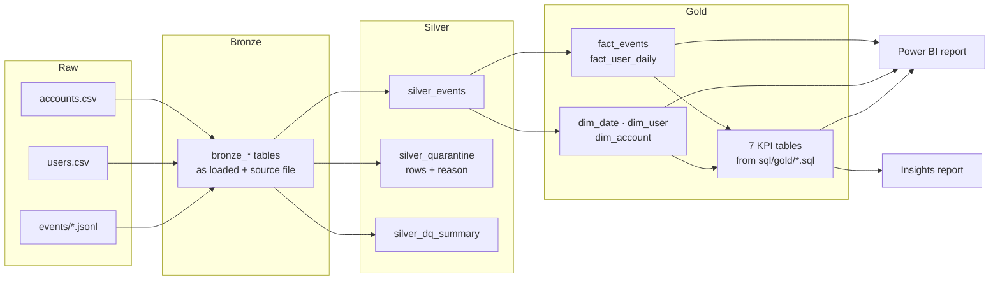

# Cloud Product Analytics

[](https://github.com/Akshitaa-V/cloud-product-analytics/actions/workflows/ci.yml)

Product analytics for a B2B cloud platform where customers upload 3D laser-scan datasets,
the platform processes them, and users open them in a web or mobile viewer to measure,
annotate, share and export.

The project covers the full path from raw tracking events to decisions:
an **ETL pipeline in PySpark and SQL** (bronze, silver, gold), **data quality checks with a
quarantine table**, a **documented KPI library**, a **star schema for Power BI**, and an
**insights report** for Product, Cloud Engineering and Customer Success. The same code runs
locally and on **Databricks** (Delta tables in Unity Catalog).

The data is synthetic but realistic: 200 customer accounts, about 1,800 users and 180,000
events over six months, with real-world problems mixed in (duplicates, broken timestamps,
unknown users and event names).

## Key findings

Computed by the pipeline; full report in [`reports/insights.md`](reports/insights.md).

- **Activation drives retention.** Users who create a first measurement or share link in
  their first week are still active in week 4 at 68 %, against 22 % for everyone else.
- **Mobile sign-ups activate less often:** 61 % of new web users activate, 38 % of mobile users.
- **A processing release slowed the pipeline.** For four weeks after version 2.8 shipped,
  median processing time rose from 15 to 25 minutes and the failure rate from 4 % to 10 %.
  The weekly KPI flags it in the first week.
- **19 of 197 accounts** used fewer than 30 % of their licensed seats in the last month.


<!-- After building the Power BI report (powerbi/BUILD.md), remove this comment line and the one at the end of this block.
## Power BI report


-->

## Architecture



| Layer | What happens | Tables |
|---|---|---|
| Bronze | Raw files loaded as they are, with source file and load time | `events`, `accounts`, `users` |
| Silver | Deduplicate, parse ISO and epoch timestamps, check 6 rules, quarantine failures | `events`, `quarantine`, `dq_summary`, `users`, `accounts` |
| Gold | Star schema and KPI tables; internal test accounts excluded | `dim_*`, `fact_*`, `kpi_*` |

## KPI library

Every KPI is defined once in [`kpis/kpi_library.yml`](kpis/kpi_library.yml) with its question,
owner, grain, formula, caveats, SQL file and Power BI measures. The readable version is
[`docs/kpi_library.md`](docs/kpi_library.md). Tests fail if the YAML, the SQL output and the
DAX measures drift apart.

| KPI | Question | Owner |
|---|---|---|
| Active users and stickiness | How many people use the platform, and how often do they come back? | Product |
| Activation rate | Do new users reach a first moment of value in week one? | Product |
| Weekly cohort retention | What share of each cohort is still active n weeks later? | Product |
| Feature adoption | Which features do active accounts use each month? | Product |
| Upload to share funnel | How many uploads get processed, opened and shared? | Cloud Engineering |
| Processing time and failure rate | How long does processing take, and how often does it fail? | Cloud Engineering |
| Account health | Which accounts use far fewer seats than they pay for? | Customer Success |

## Data quality

Nothing is dropped silently. Each rejected row lands in `silver_quarantine` with the first
rule it broke, and `silver_dq_summary` counts every check:

| Check | Action | Rows |
|---|---|---|
| duplicate_event_id | removed | 905 |
| missing_user_id | quarantined | 109 |
| unknown_user | quarantined | 54 |
| unknown_event_name | quarantined | 145 |
| unparseable_timestamp | quarantined | 27 |
| timestamp_out_of_range | quarantined | 45 |
| invalid_dataset_size | quarantined | 45 |
| epoch_timestamp_normalized | fixed | 362 |
| internal_account_event | excluded from KPIs | 2,504 |

The generator records how many problems it injected, and the tests check that every rule
catches exactly that number.

## Run it locally

You need **Python 3.10+** and **Java 17 or 21** (for Spark). On Windows (PowerShell):

```powershell
git clone https://github.com/Akshitaa-V/cloud-product-analytics.git
cd cloud-product-analytics
python -m venv .venv
.\.venv\Scripts\Activate.ps1
pip install -e ".[dev]"

python -m product_analytics.run      # generate data, run all layers, export CSVs, write report
pytest                               # 20 tests
```

On macOS or Linux, activate the environment with `source .venv/bin/activate`.

The run takes about a minute and creates:

- `data/lake/` – bronze, silver and gold tables as Parquet
- `data/powerbi/` – gold tables as CSV for Power BI
- `reports/insights.md` and `reports/charts/`

Local tables are written through Apache Arrow, so Spark does not need Hadoop to write files.

**Troubleshooting on Windows**

- `JAVA_HOME is not set` → install Temurin JDK 17 and run
  `setx JAVA_HOME "C:\Program Files\Eclipse Adoptium\jdk-17..."` (your exact folder), then open a new terminal.
- Errors that mention `winutils.exe` or `HADOOP_HOME` → download `winutils.exe` and `hadoop.dll`
  for Hadoop 3.3 into `C:\hadoop\bin`, run `setx HADOOP_HOME C:\hadoop`, and open a new terminal.
  Alternatively, run the project in WSL or on Databricks.

## Run it on Databricks

Clone the repository as a Git folder and run the notebooks `01` to `05` on serverless compute.
Tables are created as Delta tables in `workspace.product_analytics`. Step by step:
[`docs/databricks.md`](docs/databricks.md).

## Power BI

Load the gold tables (CSV or a direct Databricks connection), set up the star schema, paste the
measures from [`powerbi/measures.dax`](powerbi/measures.dax) and build three report pages.
Step by step, with expected values to check against: [`powerbi/BUILD.md`](powerbi/BUILD.md).

## Repository layout

```
src/product_analytics/   generate.py, bronze.py, silver.py, gold.py, pipeline.py,
                         kpi_library.py, export_powerbi.py, insights.py, run.py
sql/gold/                one SQL file per KPI
kpis/kpi_library.yml     KPI definitions (single source of truth)
notebooks/               Databricks notebooks (01 to 05)
powerbi/                 DAX measures and report build guide
reports/                 generated insights report and charts
tests/                   data quality, star schema, KPI SQL and library tests
docs/                    KPI library docs, Databricks guide
```

## Design decisions

- **KPIs in SQL files, not in Python.** Analysts and engineers can read and review the logic
  directly, and the same files run on a laptop and in Databricks.
- **Quarantine instead of filter.** Every rejected row keeps its reason, so data problems can
  be reported back to the teams that send the events.
- **Complete windows only.** Activation and retention leave out cohorts that have not had the
  full time to convert, so the latest weeks do not look worse than they are.
- **Pre-aggregated KPI tables and a star schema side by side.** KPI tables give fast, agreed
  numbers; the star schema lets Power BI users slice by plan, industry or country themselves.

## License

MIT
