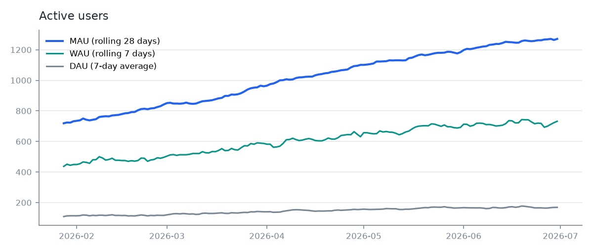
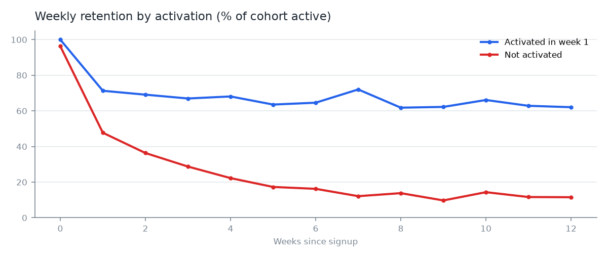
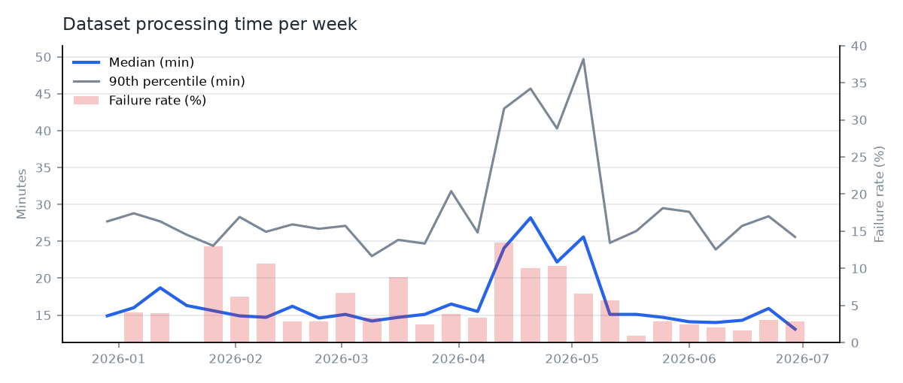

# Product insights

Generated by `python -m product_analytics.run` from the KPI tables in the gold layer. The data is synthetic, so the findings describe the simulated platform, not a real company.

## Summary

1. **Activation drives retention.** Users who reach a first measurement or share link in their first week are still active in week 4 at 68.1 %, against 22.3 % for everyone else.
2. **Mobile sign-ups activate less often.** 61.4 % of new web users activate, but only 37.8 % of new mobile users (929 new users in total).
3. **A processing release slowed the pipeline.** From the week of 2026-04-13 to the week of 2026-05-04 (4 weeks, pipeline version 2.8), median processing time was 24.9 min against a usual 15.1 min, and 10.1 % of jobs failed against 4.1 % in other weeks.
4. **Seat utilisation flags churn risk early.** In the last month, 19 of 197 customer accounts used fewer than 30 % of their seats.

## Engagement

MAU grew from 719 (2026-01-28, first day with a full 28-day window) to 1271 at the end of the period (+76.8 %). Stickiness over the last 28 days (average DAU / MAU) is 13.2 %.

## Activation and retention

Overall activation rate: 55.7 %. Retention curves split by activation:

## Upload pipeline

Across the period, 2154 datasets were uploaded, 2040 processed successfully, 1711 opened after processing and 738 shared (34.3 % from upload to share).

## Feature adoption

In 2026-06, the most adopted features were Viewer (100.0 % of active accounts) and Measurements (96.9 % of active accounts); the least adopted were Export (51.5 %) and API (12.9 %).

## Account health

Share of accounts at risk in the last month, by plan: enterprise 7.4 %, pro 10.5 %, starter 9.6 %.

## Suggested next steps

- Product: test a guided first measurement in the mobile app, since mobile sign-ups activate less often and activation is linked to retention.
- Cloud Engineering: add the weekly processing-time KPI to release checks so a slower pipeline version is caught in its first week.
- Customer Success: review accounts marked at_risk each month before their renewal date.

## Data quality

Of 181855 raw event rows, 905 duplicates were removed and 425 rows were quarantined with a reason (see `silver/dq_summary`). No row is dropped without a record.
